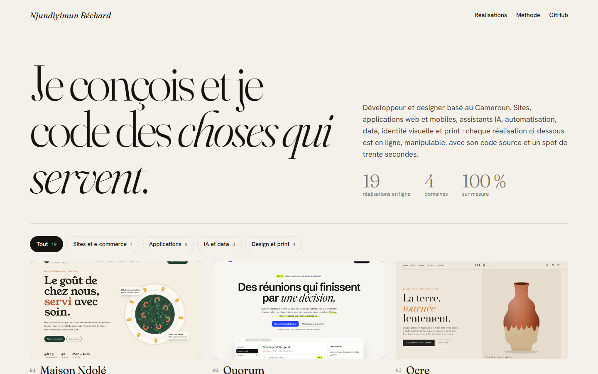
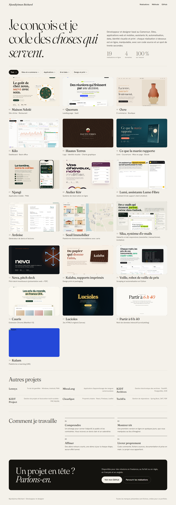
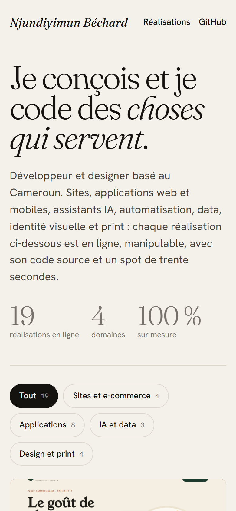

# Portfolio — Njundiyimun Béchard

**Portfolio de développeur et designer** — Page d'accueil qui rassemble toutes les réalisations : chaque projet est en ligne, manipulable, avec son spot vidéo de trente secondes, ses captures et son code source. Filtres par domaine, aperçu vidéo au survol, fiche détaillée avec navigation au clavier.

**Démo en ligne : [https://lordlennyx.github.io/portfolio/](https://lordlennyx.github.io/portfolio/)**

Spot de présentation (30 s) : [media/spot-30s.mp4](https://lordlennyx.github.io/portfolio/media/spot-30s.mp4)

## Ce que le projet montre

- Grille des réalisations générée à partir des fiches de chaque projet
- Filtres par domaine : sites et e-commerce, applications, IA et data, design et print
- Aperçu du spot vidéo au survol, fiche détaillée avec vidéo, captures, fonctionnalités et technologies
- Liens directs vers la démo en ligne et le code source, navigation précédent / suivant au clavier
- Lien partageable vers chaque fiche (ancre dans l'URL)

## Réalisation

- **Stack :** HTML, CSS, JavaScript natif, Python (génération des données)
- **Typographies :** Fraunces, Hanken Grotesk, JetBrains Mono

| Bureau | Mobile |
|---|---|
|  |  |

---

Client et contenus fictifs, créés pour la démonstration. Conception, design et développement : **Njundiyimun Béchard** — [github.com/LordLennyx](https://github.com/LordLennyx)
